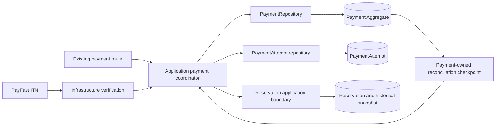

# AR-003.3 - Payment Aggregate Persistence and ITN Reconciliation Design

## Document control

| Field | Value |
| --- | --- |
| Status | Draft — For Architect Review |
| Version | 0.1.1 |
| Date | 2026-11-17 |
| Prepared for | Project Owner and Platform Architecture |
| Governing process | [GOV-DEV-001](../../../09-governance/GOV-DEV-001-DEVELOPMENT-PROCESS.md) |
| Review and approval | Architect review; Project Owner decides the proposed decisions |
| Scope | Existing canonical Reservation, Payment Aggregate, PaymentAttempt and PayFast hosted payment |
| Authority | Proposal only; no implementation, schema, migration or payment is authorised |

### Revision history

| Version | Date | Change | Approval |
| --- | --- | --- | --- |
| 0.1.1 | 2026-11-17 | AR-003.3.1 corrections: ITN and initiation recovery, complete mapping, lifecycle evidence, confirmation rules and financial exceptions | Pending architect review |
| 0.1.0 | 2026-11-17 | Initial AR-003.3 design for review | Pending |

## 1. Executive summary

The existing flow creates an in-memory Payment, persists a separate PaymentAttempt, and produces a hosted form. A verified ITN currently updates the attempt and Reservation's historical PaymentSnapshot, but does not persist the Payment Aggregate or confirm the Reservation [S1-S6]. This is not an authoritative end-to-end financial lifecycle.

**Recommendation, subject to approval:** extend the existing `payment` representation and implement one Payment Aggregate repository; persist the Payment before presenting a form; record verified financial evidence and a durable reconciliation checkpoint within the Payment boundary; then independently update the attempt and coordinate the Reservation-owned snapshot and confirmation. Each Aggregate is persisted in its own transaction. Recovery must resume from durable evidence rather than rely solely on provider retries.

Provider completion-to-canonical lifecycle mapping, the Reservation confirmation operation, the repository's layer, legacy data treatment and unmatched-notification recovery are not established by the current contracts. They are explicit approval gates, not decisions made by this document. The original Sandbox transaction remains **not ready**.

## 2. Evidence and authority baseline

### 2.1 Repository and prior evidence

AR-003.3 inspection began on `main`, HEAD `566badc7581b75fc3b124bf30fbe503d3c07cfea`, with clean `git status --short` and nothing staged. AR-003.3.1 began at the same branch and HEAD with only this draft untracked. AR-003.1's investigation report is available in session history, not as a repository file; AR-003.2's source-evidence ZIP and manifest are outside the repository. Both were re-read as investigation evidence, not implementation authority. AR-003.2 excluded a credential-bearing configuration helper and a gateway test containing credential material; its source evidence is therefore not a complete dependency closure. Current repository source and applicable approved contracts control if evidence differs.

The following are **historical AR-003.1 observations**, not refreshed database facts: Reservation `reservation-journey-homepage-journey-001-1edb5be5a03ef03e29dcc939` was `CREATED`, with ZAR 64,990.09 total and outstanding, zero received, snapshot `CREATED`, no matching PaymentAttempt, and no Payment candidate found by a bounded identity/reference or shared-Booking query. The query did not rule out every unrelated Payment. No database was accessed for AR-003.3.

### 2.2 Authority inventory and discrepancies

| Key | Actual repository authority | Applicable content and control |
| --- | --- | --- |
| A1 | [SPEC-002 v1.1.0](../../../06-specifications/engineering/SPEC-002-canonical-physical-data-model.md), §§8.2-8.10 | Approved. Payment is the separate Financial Aggregate; Reservation owns its lifecycle and historical snapshot; PaymentAttempt is separate and Reservation-linked. §8.10's application-state traceability route is limited to its stated capability, not Payment. |
| A2 | [SPEC-026 v2.0](../../../06-specifications/engineering/SPEC-026-canonical-logical-data-model%20v2.0.md), §§6, 12, 17, 21, 27 | Header Approved; footer Draft — Architect Review Required. Defines Payment as authoritative and Reservation snapshot as distinct. |
| A3 | [SPEC-027 v2.0](../../../06-specifications/engineering/SPEC-027-physical-data-model%20v2.0.md), §§20, 33-34 | Header Approved; footer Draft — Architect Review Required. Lists `payment` and related Financial tables; A7 §41 separately prohibits a parallel Payment persistence architecture. |
| A4 | [SPEC-028 v2.0](../../../06-specifications/engineering/SPEC-028-prisma-data-model%20v2.0.md), §§17, 27-30 | Header Approved; footer Draft — Architect Review Required. Preserves Aggregate boundaries and cross-domain references; §30 permits JSON only where SPEC-027 explicitly defines it. The JSON proposals below require that reconciliation. |
| A5 | [SPEC-029 v2.0](../../../06-specifications/engineering/SPEC-029-repository-persistence-architecture%20v2.0.md), §§4-7, 21, 29-30, 40 | Header Approved; footer Draft — Architect Review Required. Recognises `PaymentRepository`; Reservation repository must not modify Payment, query its live status, call PayFast or calculate refunds. Its transaction excludes unrelated Aggregate Roots and external calls. |
| A6 | [APP-006.1 v2.0](APP-006.1-payment-aggregate.md), Aggregate Architecture, Ownership Model and Lifecycle | Approved. Defines immutable Payment composition, `create`, `restore` and the canonical lifecycle. |
| A7 | [APP-006 PayFast v1.0.0](APP-006.9-payfast-provider-integration.md), §§6, 13-23, 41-42, 45 | Status says “Implementation Specification”, not explicitly Approved. Heading says APP-006; document-control ID says APP-006.8. §41 requires existing APP-006 persistence and bars schema changes unless an approved canonical contract demonstrably requires them. |
| A8 | [APP-006 Payment Capability v1.0](../../capabilities/APP-006-payment-capability.md), Lifecycle; [APP-006.2 v2.0](APP-006.2-payment-model-library.md); [APP-006.8 v1.0](APP-006.8-payment-provider-integration.md) | These separate documents state Approved. APP-006.8 is the provider-neutral integration specification; its identifier collides with A7's document-control ID. |
| A9 | [SPEC-001](../../../06-specifications/engineering/SPEC-001-canonical-domain-model.md), Domain Layer, Dependency Rules and Repository Rule | Filename says canonical-domain-model, but its actual title is “Project Structure & Folder Layout”, v1.0 Approved. It puts business logic and repository interfaces in the domain layer. A6 explicitly locates Payment in the application layer. The apparent layer conflict requires owner reconciliation; neither is silently overridden. |
| A10 | [APP-004.1](../reservation/APP-004.1-reservation-aggregate.md), Reservation Status and Snapshot Principle; [APP-004.2](../reservation/APP-004.2-reservation-snapshot-model-library.md), Payment Snapshot | Approved Reservation composition and snapshot contracts. APP-004.1 describes status and immutable snapshots, not a complete confirmation operation. |
| A11 | [ADR-001 v1.0.0](../../../decisions/ADR-001%20%E2%80%93%20Booking%2C%20Reservation%20and%20Supplier%20Booking%20Semantics.md), §§3 and 23 | Header and opening say Approved, but §23 review and final-decision fields say Pending. The responsible owner must resolve this discrepancy. |
| A12 | [ADR-003 v0.2](../../../decisions/ADR-003-durable-journey-workflow-state.md) | Approved amendment context referenced by A1; it is not authority for Payment persistence or a payment solution. |
| A13 | [ADR-000 v1.0.0](../../../decisions/ADR-000-architecture-decision-record-standard.md), §§4-5, 13-15 | Approved ADR governance. Whether any proposed decision requires a new or amended ADR must be decided under this standard. |

The owners of A2-A5 and A11 must confirm document control before dependent implementation. A7's status and identifier collision also require clarification. Nothing here changes document status.

### 2.3 Source evidence

| Key | Current repository source and observed responsibility |
| --- | --- |
| S1 | [`Payment`](../../../../src/application/payments/aggregate/payment.ts), `create`/`restore`; [`PaymentStatus`](../../../../src/application/payments/models/lifecycle/payment-status.ts); [`PaymentEvent`](../../../../src/application/payments/models/lifecycle/payment-event.ts); [`PaymentEngine.execute` and `DefaultPaymentAggregateFactory.create`](../../../../src/application/payments/engine/payment-engine.ts). Construction is immutable; no Aggregate lifecycle methods or production restoration path were identified. |
| S2 | [`DefaultPaymentInitiationService` and `CanonicalReservationPaymentContextResolver`](../../../../src/application/payments/payment-initiation-service.ts); [`PaymentAttempt`](../../../../src/application/payments/payment-attempt.ts); [`PaymentAttemptPrismaRepository`](../../../../src/infrastructure/persistence/repositories/payment-attempt-prisma.repository.ts). Derived Payment ID is a string; attempt `paymentId` is not a Payment foreign key. |
| S3 | [PayFast gateway and hosted form](../../../../src/infrastructure/payments/payfast/index.ts), `DefaultPayFastGateway.execute`/`executeCustomPayment`; [frontend controller](../../../../src/interfaces/http/controllers/frontend.controller.ts), `initiatePayment`; [payment template](../../../../src/interfaces/views/pages/payment-experience.ejs). Form construction is not an actual provider outcome. |
| S4 | [Express bootstrap](../../../../src/bootstrap/express.ts), [ITN controller](../../../../src/interfaces/http/controllers/payfast-itn.controller.ts), [ITN security helpers](../../../../src/infrastructure/payments/payfast/payfast-itn-security.ts), [ITN processor](../../../../src/infrastructure/payments/payfast/payfast-itn-processor.ts), `process`. Security verification precedes the attempt lookup; server validation is outside the database transaction. |
| S5 | [`transitionReservationFromVerifiedPayFastNotification`](../../../../src/application/payments/verified-payfast-notification-transition.ts); [`applyVerifiedPayFastNotification`](../../../../src/infrastructure/persistence/repositories/payment-attempt-prisma.repository.ts); [Reservation repository](../../../../src/infrastructure/persistence/repositories/canonical-reservation-prisma.repository.ts). The current transaction conditionally writes attempt and snapshot, not Payment or Reservation lifecycle. |
| S6 | [Canonical application Reservation](../../../../src/application/reservations/aggregate/reservation.ts), [PaymentSnapshot](../../../../src/application/reservations/models/snapshots/payment-snapshot.ts), [confirmation resolver](../../../../src/application/reservations/confirmation/reservation-confirmation-service.ts), [legacy domain `Reservation.confirm`](../../../../src/domain/aggregates/reservation.aggregate.ts) and [legacy caller](../../../../src/application/services/reservation/confirm-reservation.service.ts). The canonical class has `create`/`restore`, not a confirmation method. The different legacy method requires `PENDING`; its service is not identified in the PayFast path. |
| S7 | [Prisma schema](../../../../prisma/schema.prisma), models `Payment`, `PaymentAttempt`, `Reservation`, `Refund`, `PaymentStatus`, `Currency`, `PaymentMethod` and `FinancialReconciliation`. A model alone does not demonstrate a repository or a complete Aggregate mapping. |
| S8 | [ITN processor tests](../../../../src/infrastructure/payments/payfast/payfast-itn-processor.test.ts), [attempt repository tests](../../../../src/infrastructure/persistence/repositories/payment-attempt-prisma.repository.test.ts), [snapshot transition tests](../../../../src/application/payments/verified-payfast-notification-transition.test.ts), [Payment Aggregate tests](../../../../src/application/payments/aggregate/payment.test.ts), [initiation tests](../../../../src/application/payments/payment-initiation-service.test.ts), [confirmation tests](../../../../src/application/reservations/confirmation/reservation-confirmation-service.test.ts). These are source evidence, not results from this design task. |
| S9 | [Anonymous-session middleware](../../../../src/interfaces/http/middleware/anonymous-session.middleware.ts), [frontend routes](../../../../src/interfaces/http/routes/frontend.routes.ts), and [frontend controller](../../../../src/interfaces/http/controllers/frontend.controller.ts), `resolvePaymentJourney` and `resolvePaymentContext`. A session and CSRF check do not by themselves prove authority over the selected Reservation. |

## 3. Current and target boundaries

Payment owns identity, Reservation reference and immutable Reservation snapshot, optional Quote snapshot, Pricing snapshot, amount, currency, method, status, authorization, capture, settlement, refunds, timeline and metadata [A6, S1]. It is authoritative for the financial outcome. PaymentAttempt remains a distinct Reservation-linked entity representing one attempt [A1, S2]; it is not a substitute for Payment. Reservation owns its historical PaymentSnapshot and its own lifecycle [A1, A5, A10].

The application coordinates these owners. The Payment repository must not update Reservation; the Reservation repository must not update Payment or contact PayFast. This proposal includes no other Aggregate Root or provider call in either repository transaction [A1, A5]. A Payment-owned recovery checkpoint proposed below is financial reconciliation evidence, not a new Reservation, workflow-state mechanism or independent Payment Aggregate.



Arrows show application coordination or separate persistence access, **not** a shared transaction. The names of new contracts and coordinator operations below are proposed, not existing methods or approved implementation interfaces.

## 4. Identity and relationship mapping

| Concept | Current source | Proposed mapping for review |
| --- | --- | --- |
| Payment Aggregate identity | `Payment.reference.paymentId`; resolver derives `payment-${reservationId}` [S1, S2]. | Retain that deterministic value for the existing Reservation's first supported full-payment flow, after collision and legacy checks. Persist it as `Payment.id` for the new canonical record. Prisma `String` permits a non-UUID value; do not assume any other consumers do. This scoped choice does **not** approve a general one-Payment-per-Reservation rule. |
| Payment's Reservation reference | `Payment.reference.reservationId` and `reservationSnapshot.reservationId` [S1]. | Both must equal a verified `Payment.reservationId`; the snapshot also retains its historical reference. Booking identity is not proof of Reservation identity. |
| Prisma Payment reference | Existing `Payment.paymentReference` is a distinct unique string [S7]. | For newly created records only, use the canonical Payment ID as this business reference unless review establishes a different existing contract. Keep the existing unique column and reconcile legacy values; never treat it as the attempt reference. |
| Attempt identity | `PaymentAttempt.id` [S7]. | Distinct durable attempt identity; no inference that it is a Payment ID. |
| Attempt idempotency key | `PaymentAttempt.idempotencyKey`; current resolver uses the derived Payment ID as `requestId` [S2]. | Stable per approved initiation operation. Repeating the same key returns the same attempt only if Payment, Reservation, provider, environment, amount and currency match. A new attempt after a terminal outcome requires a separately approved retry policy and new key. |
| GCT attempt/provider-facing reference | `PaymentAttempt.paymentReference`, currently `gct-...`; sent as PayFast `m_payment_id` [S2, S3]. | Remains distinct and unique; resolves exactly one attempt. `m_payment_id` is not presumed to be `Payment.id` or `Payment.paymentReference`. |
| Provider transaction | PayFast `pf_payment_id` -> `PaymentAttempt.providerTransactionId`; Aggregate has provider-neutral `TransactionReference` [S1, S4]. | Validate and preserve the provider transaction in the attempt and the Aggregate's provider-neutral transaction/evidence representation. Keep the existing uniqueness guard unless an approved provider/environment-scoping change replaces it. |

Recommended integrity: a new attempt may be inserted only after its Payment exists; enforce a `PaymentAttempt.paymentId -> Payment.id` foreign key after legacy validation and backfill. Verify attempt Reservation ID equals Payment's Reservation ID on every initiation and ITN; a composite database constraint is an option if approved. `PaymentAttempt.reservationId -> Reservation.id` remains. These are references, not cross-Aggregate ownership. Neither total cardinality nor cascading deletion is inferred from the current FK [A1-A5, S7].

## 5. Payment lifecycle and immutable operations

### 5.1 Existing contract and gaps

A6 describes `Created -> PendingAuthorization -> Authorized -> Captured -> Settled -> Completed`, plus `Created -> AuthorizationFailed -> Cancelled` and `Captured -> RefundRequested -> Refunded`. Current code uses `CREATED`, `AUTHORIZATION_REQUESTED`, `AUTHORIZED`, `CAPTURED`, `SETTLED`, `COMPLETED`, `AUTHORIZATION_FAILED`, `CANCELLED`, `REFUND_REQUESTED` and `REFUNDED`, with additional `CAPTURE_REQUESTED` and `SETTLEMENT_REQUESTED` values [S1]. `AUTHORIZATION_REQUESTED` is the candidate mapping for “PendingAuthorization”, subject to approval. Status enums and processing pipelines exist; the immutable Aggregate has no methods enforcing transitions.

For the present hosted one-off flow, creation, authorization request, verified success or cancellation, and recovery are required. No form rendering, browser return, pending response or network timeout is evidence of authorization, capture, settlement or completion [A7, S3-S4]. Existing authorization/capture/settlement/refund models represent those stages, but do not prove any stage occurred.

### 5.2 Proposed operations and invariants

Subject to A6/A8 and owner approval, add immutable operations such as `requestAuthorization`, `recordVerifiedOutcome` and `cancelAfterVerifiedOutcome`; names are illustrative. Each returns a new Payment and leaves the prior instance and immutable commercial snapshots unchanged. Future full refund operations must enforce the A6 refund path; implementing refunds or partial payments is outside this iteration.

| Candidate transition | Guard and effect |
| --- | --- |
| `CREATED -> AUTHORIZATION_REQUESTED` | Persist the immutable Reservation/pricing context and positive supported amount first; append an authorization-request event once. A repeated operation with the same identity is idempotent, not a second transition. |
| Requested -> verified success | **Approval gate:** decide whether PayFast `COMPLETE` meets the canonical meaning of `COMPLETED`, and whether a direct provider-completion operation is an approved exception to A6's staged lifecycle. Do not invent `AUTHORIZED`, `CAPTURED` or `SETTLED` records or timestamps from a single notification. Preserve the verified evidence even if it cannot yet be mapped. |
| Requested -> verified cancellation / authorization failure | Approve the precise mapping and permitted predecessor. Do not fabricate `AUTHORIZATION_FAILED` merely to traverse the alternative diagram. Unknown/pending remains non-successful. |
| `AUTHORIZED -> CAPTURED -> SETTLED -> COMPLETED` | Only with evidence sufficient for each approved stage; use existing statuses and validated records. Not automatically asserted by the hosted form. |
| `CAPTURED -> REFUND_REQUESTED -> REFUNDED` | Retain the approved alternative for a future scoped refund iteration; preserve refund history in persistence now without initiating refunds here. |

Every operation validates predecessor, identity, amount/currency and evidence; rejects invalid or conflicting repeats; and appends exactly one appropriate timeline event. Existing event types lack an explicit completed/cancelled event, so any added canonical event types and outcome semantics require an A6/A8 amendment. Store only provider-neutral reference and approved evidence, not secrets or fabricated stage records. `Payment.restore` reconstructs the complete committed composition without replaying business actions; malformed/unknown values fail explicitly [S1].

### 5.3 Provider outcome, canonical status and evidence

These are different facts: a provider's verified report; the Payment-owned canonical lifecycle status; and evidence sufficient to establish each particular financial stage. A verified report is not, by itself, proof that every canonical intermediate stage occurred.

| Stage | Evidence actually identified in current path; proposed treatment |
| --- | --- |
| Authorization | Hosted form creation and an authorization *request* exist; neither establishes authorization. No independently verified authorization result for the hosted ITN path was identified. |
| Capture | Gateway code can label a requested CAPTURE as captured while constructing a form [S3]; that label is not evidence that funds were captured. Require independent approved capture evidence before a capture record. |
| Settlement | Likewise a SETTLE operation label is not proof of settlement. `COMPLETE` alone does not establish a settlement date, amount or record. |
| Completion | Verified ITN `COMPLETE` reports provider completion after signature and server validation; current adapter maps it to `COMPLETED`, but no persisted Aggregate transition exists. Its exact financial meaning and compatibility with A6's staged lifecycle remain unresolved. |
| Cancellation / failure | Verified `CANCELLED` reports provider cancellation, not necessarily a proved authorization failure. Current ITN accepts only `COMPLETE`/`CANCELLED`; status-query normalization maps `FAILED` to cancellation [S3-S4], which is not an approved lifecycle equivalence. |
| Refund | Gateway has refund eligibility and request operations, not a traced persisted Aggregate refund transition [S3, A7 §§24-29]. A separately verified refund result and approved refund rules are required; original `COMPLETE` is not refund evidence. |

**D05 alternatives:** (1) require independently evidenced authorization, capture and settlement before canonical `COMPLETED`, retaining `COMPLETE` as an unmapped provider outcome until those proofs exist; (2) approve a provider-neutral direct completion transition whose meaning explicitly matches verified PayFast `COMPLETE`, without manufacturing intermediate records; or (3) retain outcome without automatic completion and resolve manually. Recommend (2) only if the architect, Project Owner and specification owners approve the meaning, event and an explicit A6/A8 lifecycle amendment; otherwise use (1) or (3), with no automated confirmation.

When a verified outcome cannot be legally mapped, Payment's local transaction records its normalized verified evidence and pending/manual checkpoint while leaving canonical status unchanged. It must not pretend this is a successful canonical transition. Replays compare the same evidence, and operations reconcile it; if Payment cannot be located, use §8.5's exception path. If P1 fails after A1, recover from A1's durable evidence as in §8.2; if neither can persist, alert and follow the outage procedure.

## 6. Proposed Payment persistence model

### 6.1 Repository contract and layering

One persistence-neutral `PaymentRepository` should expose `findById`, creation with identity conflict detection, and a conditional save of the complete immutable Aggregate with an expected persistence revision. Lookup by provider reference is only added if required by approved reconciliation. Save returns a new revision or a conflict/not-found result; database-specific types, transactions and provider calls stay in infrastructure [A5].

A6 locates the Aggregate in `src/application/payments`, while A9 requires domain repository interfaces and forbids outward dependencies. **Recommended decision:** reconcile A9 and A6 explicitly for this capability before choosing the repository interface location; either approve the existing application-layer Aggregate and a narrowly scoped persistence-neutral interface, or approve moving the canonical contracts inward without creating a second Aggregate. Do not make a domain interface import application types or claim an exception already exists.

### 6.2 Mapping assessment

The current Prisma `Payment` has a mandatory Booking FK, reference, amount `Decimal(19,4)`, method/currency/status reference rows, timestamps, `gatewayResponse`, integer `version`, and relations to Allocation, Refund and Adjustment [S7]. It has no direct Reservation reference and no complete Reservation/Quote/Pricing snapshots, lifecycle records, timeline or Aggregate metadata. The Reservation's own `bookingId` is optional [S7]. Therefore a Booking FK alone cannot reconstruct A6, and the model **cannot be reused unchanged** for this capability.

Extending the existing `payment` model and its existing owned `refund` representation is recommended over a parallel Payment table. A6's approved composition demonstrates why additional representation is needed, but A7 §41 does **not** by itself approve these particular schema changes. A2-A5, A6/A8 and the owner must reconcile and approve the physical/Prisma contract and migration first.

### 6.3 Aggregate-to-physical mapping matrix

The following is a **proposal**, not approved schema. `Restore` means reconstruct the indicated `PaymentComposition` member and then call `Payment.restore`; validate first and never run a transition while restoring. Unless stated otherwise, approval requires the Project Owner after architect review and the owning SPEC-027/028 and APP-006.1/006.2 specification owners; SPEC-029 must approve repository semantics. No cell asserts an amendment is already approved.

| APP-006.1 member | Existing domain property | Existing Prisma field/model | Proposed physical representation | Source of truth | Reconstruction into `Payment.restore()` | Schema amendment? | Approval authority |
| --- | --- | --- | --- | --- | --- | --- | --- |
| Payment identity | `reference.paymentId` | `Payment.id` | Existing ID; deterministic ID only for scoped new flow (§4). | Payment row ID | Populate `reference.paymentId`. | No column; identity policy yes. | Owner; A6/A3-A5 owners. |
| Payment reference | `reference` including `quotationNumber` | unique `paymentReference`; no quotation number | Retain business reference for compatibility; add `quotationNumber String?`. Proposed new business reference equals ID, not attempt reference. | ID for Aggregate identity; column for physical business reference; quotation column for optional quotation number. | Use ID and quotation column; do not infer quotation number from reference. | Yes, quotation column. | Owner; A6/A3-A5 owners. |
| Reservation identity | `reference.reservationId` | no direct Payment FK | Add nullable indexed `reservationId` with restrictive FK; required for canonical rows. | Payment FK | Set reference ID; compare snapshot ID. | Yes. | Owner; A1-A5/A6 owners. |
| Reservation snapshot | `reservationSnapshot` | none | `reservationSnapshot Json?`, versioned; required for canonical rows. | Immutable Payment-owned snapshot; reference ID must match FK. | Validate and reconstruct `snapshotId`, `capturedAt`, `version`, `reservationId`, `reservationReference`. | Yes; A3/A4 JSON authorization. | Owner; A3/A4/A6 owners. |
| Quote snapshot | `quoteSnapshot?` | none | `quoteSnapshot Json?`, optional versioned. | Immutable snapshot | Reconstruct `snapshotId`, `capturedAt`, `version`, `quoteId`, `quotationNumber`, `expiresAt`; compare optional reference quotation number when both present. | Yes. | Owner; A3/A4/A6 owners. |
| Pricing snapshot | `pricingSnapshot` | none | `pricingSnapshot Json?`, required for canonical rows. | Historical Payment pricing snapshot, not mutable current Reservation price. | Restore snapshot identity/date/version, pricing ID, subtotal, taxes, discounts, fees, total and currency using §6.6 exact decimal contract. | Yes. | Owner; A3/A4/A6 owners. |
| Amount | `paymentAmount` | `Payment.amount Decimal(19,4)` | Existing column; exact decimal, not binary number. | Payment.amount for this transaction; snapshot price is historical context, not a second payment amount. | Parse exact decimal under §6.6; reject unsupported legacy scale/range. | No column; domain precision amendment. | Owner; A6/A8 and A3/A4 owners. |
| Currency | `currency` | `currencyId` -> `Currency.code` | Existing lookup; approved code mapping. | Payment currency FK/code | Resolve code, reject missing/unknown; check snapshot/attempt context. | No column; contract review. | Owner; A6/A8 and reference-data owners. |
| Method / instrument | `paymentMethod`, `paymentInstrument?` | `paymentMethodId` -> `PaymentMethod.code`; no instrument | Existing lookup; optional `paymentInstrument Json?` containing only approved masked fields. | Method FK; instrument snapshot if permitted. | Resolve method; validate instrument type, masked ID, optional holder and expiry. | Instrument JSON if retained. | Owner; A3/A4/A6 and privacy owners. |
| Status | `status` | `paymentStatusId` -> `PaymentStatus.code` | Existing FK; approved canonical code map. | Payment status FK alone governs current canonical lifecycle. | Resolve code; fail for unknown or unmappable legacy values. | No column; mapping/reference-data approval. | Owner; A6/A8 and reference-data owners. |
| Authorization | `authorization?` | none | `authorization Json?`: ID, authorizedAt, exact amount, currency, provider reference, stage status. | Payment-owned historical stage record; absent without stage evidence. | Validate version, types, dates, status and exact money, then restore. | Yes; JSON authorization. | Owner; A3/A4/A6 owners. |
| Capture | `capture?` | none | `capture Json?`: capture ID, capturedAt, exact amount, currency, provider reference, stage status. | Payment-owned evidenced stage record, not current Payment status. | Validate and restore or leave absent. | Yes; JSON authorization. | Owner; A3/A4/A6 owners. |
| Settlement | `settlement?` | none | `settlement Json?`: settlement ID, optional batch, provider reference, settledAt, exact amount, currency, stage status. | Payment-owned evidenced stage record. | Validate and restore or leave absent. | Yes; JSON authorization. | Owner; A3/A4/A6 owners. |
| Transaction reference | `transactionReference?` | `transactionReference String?` | Keep as canonical transaction ID; add `providerCorrelationId String?` and `customerReference String?`. | Payment transaction-reference columns; Attempt provider ID is correlation index (§6.4). | Reconstruct complete `TransactionReference` when ID exists; reject orphan detail columns. | Yes, optional detail columns. | Owner; A3-A6 owners. |
| Refund history | `refunds` | related `Refund` rows | Reuse and amend existing rows (§6.5); never duplicate refund ledger in JSON. | Refund rows within Payment boundary. | Load all ordered associated rows, validate and reconstruct immutable `RefundRecord[]`. | Yes. | Owner; A3-A6/A8 owners. |
| Timeline | `timeline` | none | `paymentTimeline Json?`: ordered event type, occurredAt, optional note and historical transaction reference. | Payment timeline for history; status FK governs current status. | Validate ordered versioned events and enum codes; restore array without replay. | Yes; JSON authorization. | Owner; A3/A4/A6/A8 owners. |
| Metadata | `metadata` | `createdAt`, `updatedAt`, `createdBy`, `updatedBy` | Reuse these columns; add `metadataVersion`, `metadataSource`, `auditPresent`, optional `correlationId`, `requestId`, `traceId`. | Existing timestamp/audit columns and proposed metadata columns. | Restore metadata timestamps, semantic version, source and optional audit; `auditPresent` distinguishes absent from present-empty audit. No duplicate metadata JSON. | Yes. | Owner; A3/A4/A6 owners. |
| Concurrency revision | No Aggregate member; repository revision | `Payment.version Int` | Existing integer CAS, returned separately from Payment. | Payment.version | Pass revision alongside, not as `metadata.version`. | No column; contract approval. | Owner; A5/A6 owners. |
| Verified outcome evidence | Not an existing Aggregate member | `gatewayResponse Json?` is not verified ITN evidence | Proposed `outcomeEvidence Json?`, versioned collection of minimal normalized verified observations; §8.2. | Payment-owned record of provider observations; not canonical status. | Repository exposes separately to coordinator; do not invent a `PaymentComposition` member. | Yes; Financial traceability/JSON authorization. | Owner; A1-A5/A7 owners. |
| Recovery checkpoint | Not an Aggregate member | none | Proposed `reconciliationState Json?`, `reconciliationPending Boolean`, `reconcileAfter DateTime?` and selector index. | Payment-owned operational progress; no financial outcome authority. | Load separately with revision; not passed to `Payment.restore`. | Yes; Financial traceability/JSON authorization. | Owner; A1-A5/A7 and operations owners. |

### 6.4 Source-of-truth and consistency contracts

| Overlap | Authority and consistency rule |
| --- | --- |
| Current Payment status vs stage records/timeline | `paymentStatusId` is the sole current lifecycle status; stage JSON and timeline are immutable historical evidence, not independently writable status authorities. A6 must define permitted combinations. Write Payment status, timeline and evidence atomically with CAS. |
| `transactionReference` vs structured details | Existing `transactionReference` is the sole canonical transaction ID; detail columns contain only correlation/customer references, not another transaction ID. Historical timeline copies are labelled as past event context. |
| `gatewayResponse` vs `outcomeEvidence` | `gatewayResponse` is legacy/provider response data, not verified evidence or status authority. New verified observations go in Payment evidence; never infer verification from a legacy payload. Protect existing data and do not copy credentials or raw ITNs into new evidence. |
| Refund rows vs Aggregate refunds | Existing amended Refund rows are the only persisted refund ledger; the Aggregate's immutable array is reconstructed from them within the Payment boundary. No second refund JSON. |
| `Payment.version` vs `metadataVersion` | Integer version is persistence CAS; metadata version is the Aggregate's semantic model version. Neither is derived from the other. |
| Attempt provider ID vs Payment transaction ID | Attempt's uniquely guarded provider ID is the correlation claim; Payment's reference and outcome are authoritative for the financial Aggregate. Payment write must verify the claimed provider/environment/ID, or retain an exception; correlation alone is never success. Identical IDs are intentional cross-boundary correlation copies, not independently writable financial outcomes. |
| `FinancialReconciliation` vs Payment checkpoint | `FinancialReconciliation` stores date, type, status, counts and notes [S7], not per-notification evidence or resumable Payment progress. Payment checkpoint owns its own downstream recovery; a separately approved exception record handles unassociated verified notifications (§8.5). No assumption that the existing model already implements either contract. |

### 6.5 Refund and JSON representation

`Refund.id` is proposed as canonical `refundId`; existing `paymentId` remains the restrictive Payment association. `amount Decimal(19,4)` and a proposed nullable `currencyId` FK store refund money; require currency for canonical rows, do not infer it for legacy rows without evidence. `refundStatusId` resolves the canonical status code. Existing nullable `refundReason` must be present for new canonical records because `RefundRecord.reason` is required. Add `requestedAt DateTime?`, provider identifier/reference and optional correlation ID; require the first three for canonical rows because the domain requires `requestedAt` and `providerReference`. Make `refundedAt` nullable for a requested refund, setting it only on evidence of completion. Preserve existing unique `refundReference` as the legacy/business reference, not a second canonical refund identity; specify how it relates to provider reference before backfill. Restore by reading rows in a deterministic `requestedAt,id` order, validating identity, status, amount, currency and references, then constructing all `RefundRecord` fields. Define treatment of soft-deleted refund rows explicitly before implementation; do not silently omit historical financial facts. Existing legacy rows lacking these facts remain preserved but cannot be restored as complete canonical records until evidenced and reconciled; do not invent values.

All proposed JSON requires **prior SPEC-027 §20 and SPEC-028 §30 amendment**. Snapshots are cohesive immutable historical values and stage records are optional, low-cardinality owned values; they are candidates for JSON rather than separate business entities. Timeline is an ordered owned history, and evidence/checkpoint are bounded operational records. For each, the mapper validates a top-level `schemaVersion`, exact required fields listed in §6.3, permitted enum codes, ISO-8601 timestamps, size bounds and no extra secret/raw payload; timeline and evidence arrays are enclosed in versioned objects rather than used as the JSON root. Snapshot content never changes after creation; stage evidence and timeline are append/immutable historical facts updated only through Payment; evidence is append-only by outcome identity; checkpoint is mutable CAS-controlled progress. Money inside any JSON is a canonical decimal string, never a JSON number.

`paymentInstrument` contains only the masked fields listed in §6.3; its holder field requires a separate privacy decision. `outcomeEvidence` contains outcome ID, attempt ID, provider/environment, provider transaction reference, normalized outcome, verified gross/currency context, body digest, received/verified timestamps and validation provenance; it records an observation, not a new status. `reconciliationState` contains outcome ID, stage, attempts, claim owner/generation, lease expiry, next action, last error code and resolution reference, not another financial outcome. Attempt-owned `correlationEvidence` contains the same minimal versioned verified observation for recovery before P1; it is immutable for a given evidence identity, bounded and validated with the same decimal/date/version rules. It is an ingress correlation/recovery copy, not a second authority over Payment status. Unknown schema versions, malformed JSON, unknown enums, invalid dates or money cause explicit restoration failure and an operational alert; no silent defaults. A relational child model is preferable for unbounded history, financial querying, uniqueness, referential integrity or selective updates; architect/specification owners must choose it instead if those needs make bounded JSON unsuitable.

### 6.6 Proposed Prisma outline, precision and legacy migration

The outline is partial and deliberately omits unchanged relations and metadata; it is **not** a migration or drop-in schema. All fields are proposed and remain subject to §6.3 approvals.

```text
Payment: existing id, paymentReference, amount Decimal(19,4), currencyId,
  paymentMethodId, paymentStatusId, transactionReference, version, timestamps,
  gatewayResponse, allocations/refunds/adjustments retained;
  bookingId String?; paymentDate DateTime? (@db.Date, pending semantic approval);
  reservationId String? + restrictive FK/index; quotationNumber String?;
  persistenceFormat String; reservationSnapshot Json?; quoteSnapshot Json?;
  pricingSnapshot Json?; paymentInstrument Json?; authorization Json?;
  capture Json?; settlement Json?; paymentTimeline Json?;
  providerCorrelationId String?; customerReference String?;
  metadataVersion String?; metadataSource String?; auditPresent Boolean?;
  correlationId String?; requestId String?; traceId String?;
  outcomeEvidence Json?; reconciliationState Json?;
  reconciliationPending Boolean; reconcileAfter DateTime? + selector index;
  index (persistenceFormat, createdAt) for unattempted-Payment monitoring.
Refund: retain id, paymentId FK, refundReference, amount, refundReason,
  refundStatusId and audit; add currencyId String? FK, requestedAt DateTime?,
  providerIdentifier String?, providerReference String?, providerCorrelationId String?;
  change refundedAt to DateTime?.
PaymentAttempt: retain reservation FK, providerTransactionId unique guard and
  existing fields; add restrictive paymentId -> Payment.id FK, handoffState String?,
  initiationGeneration Int, initiationClaimUntil DateTime?,
  correlationEvidence Json?, correlationPending Boolean,
  correlationRetryAt DateTime? + pending selector index.
```

`persistenceFormat` distinguishes `LEGACY` from `CANONICAL_V1`; preserve existing rows as legacy and require explicit canonical format on new writes. Approved database checks should require canonical Reservation ID, snapshots, timeline, metadata fields and either a Booking association or canonical format; require complete canonical Refund fields. Checks must distinguish JSON null from SQL NULL and validate shape at the mapper. Verify necessary SQL constraints separately. `bookingId` becomes nullable only for approved canonical context. Existing `paymentDate` is mandatory even before a verified payment; its meaning must be clarified and nullable treatment approved rather than fabricating a payment date. `receivedAt` is set only when supported by evidence.

**Exact money proposal:** use decimal strings or an exact decimal value object throughout amended Payment, pricing/snapshot, attempt, gateway and Reservation contracts; no JavaScript `number` for authoritative money. Persistence remains `Decimal(19,4)` (at most 15 integer and four fractional digits); the initial ZAR flow permits values exactly expressible in cents, including database trailing zeroes, compares integer cents using arbitrary-precision integers and rejects nonzero excess precision, overflow, negative or inappropriate zero values. Encoding normalizes accepted ZAR values to two fractional digits without rounding. Reconstruct decimal exactly from the database string, never via `Number`. Validate Payment/attempt/gross currency and cents before credit, use exact add/subtract for Reservation snapshot, and exact refund arithmetic and currency checks. Other currencies/scales and any conversion require their own approved contract. Current Payment and Reservation snapshot implementations use number-based models [S1, S6]; amend APP-006.1/006.2, APP-004.2 and affected provider contracts before implementation rather than claiming exact representation already exists.

Migration, only after approval: inventory existing Payment/Refund/Attempt and Booking consumers; add compatible nullable fields and format classification; backfill only proven facts, preserving legacy rows and unresolved records; validate codes, identity, exact decimal range, FK, round trips and readers before enforcing new constraints. Resolve existing orphan attempts and identity collisions explicitly. Use an expand/contract deployment and separately approved backups, restoration and rollback plan: before new writes, rollback may disable the new path and retain additive columns; after canonical writes or nullable Booking use, an old reader/schema may be incompatible, so stop traffic and reconcile/export those writes before any reversal. Never drop financial evidence or fabricate legacy snapshots, statuses, dates or refund references to make rollback possible.

## 7. Initiation for the existing Reservation

### 7.1 Proposed sequence

```mermaid
sequenceDiagram
  participant U as Existing customer route
  participant C as Payment initiation application service
  participant R as Reservation boundary
  participant P as PaymentRepository
  participant A as PaymentAttempt repository
  participant G as Provider gateway
  U->>C: initiate for authorised existing Reservation
  C->>R: load current Reservation and pricing
  C->>C: validate payable state and immutable context
  C->>P: find or create Payment by unique approved identity
  alt concurrent create or existing Payment
    P-->>C: reload existing Payment
    C->>C: compare immutable context; stop on conflict
  end
  P-->>C: persisted Payment and revision
  C->>A: create/find attempt linked to persisted Payment
  C->>A: fenced conditional claim
  C->>P: CAS authorization-requested transition
  C->>G: construct hosted form outside transactions
  G-->>C: signed hosted form
  C->>A: fenced mark that form may be presented
  C-->>U: form only after required durable writes succeed
  Note over C,A: Interruptions resume per §7.2; ambiguous handoff is not reissued.
```

The application rechecks Reservation eligibility and authoritative pricing, then creates or retrieves the Payment before an attempt. Reuse requires equality of Reservation ID and reference, the complete immutable Reservation and pricing snapshots, any Quote snapshot, exact amount, currency and method under an approved stable snapshot comparison; snapshot generation timestamps must not be blindly regenerated and compared. A create race resolves by unique Payment identity: reload the winner, validate all context and return a conflict on mismatch, never replace it. A collision on the separate unique business reference is also investigated; do not assume it identifies the same Payment. No PaymentAttempt may be created against a missing Payment. Foreign-key enforcement is a defence after approved migration, not a replacement for validation.

Create/find and claim the attempt using its stable idempotency key and a fenced conditional claim [S2]. Persist Payment's authorization-requested state before exposing the form. Gateway form creation is local; it does not prove that the browser submitted it or that PayFast accepted payment [S3]. If a durable prerequisite fails, do not expose a form; surface the failure. A retry may resume an interrupted initiation only while durable state proves no handoff could have occurred. A claim generation/lease fences an expired worker so it cannot later send a competing form.

Before returning the form, conditionally persist that it **may have been presented**. If the process crashes or the response becomes ambiguous after this marker, do not automatically reissue a payable form even if the browser did not actually receive it; follow the provider-query/manual reconciliation policy. This conservative marker closes the crash window between durable state and the HTTP response. Claims, conditional transitions and recovery must avoid the current unconditional `updateStatus` overwriting a concurrent terminal result [S2].

After an ambiguous browser submission or provider timeout, do not issue another potentially payable form or create another attempt automatically. Use the existing provider-neutral status-query abstraction when an approved provider reference is available; otherwise retain pending state and route to operational reconciliation [A7 §§22-23]. A verified financial outcome is never inferred from browser return.

### 7.2 Initiation interruption and recovery matrix

| Durable boundary / case | Required retry and recovery |
| --- | --- |
| Before Payment commit | Retry lookup by approved identity; only create if no row exists and current authorised context still matches. An uncertain commit is resolved by reload, not another ID. |
| Payment commit succeeds; attempt create fails | Surface failure; next initiation reloads the same Payment and compares all immutable context, exact amount, currency and method. Create/find an eligible attempt only with the approved stable idempotency key and retry policy. No missing attempt implies no replacement Payment. |
| Concurrent Payment creates | Unique identity admits one winner; losers reload the committed winner and compare context. A different business-reference collision or mismatch is a conflict/manual review; no overwrite or alternate ID. |
| Attempt created; claim fails | Reload by stable idempotency key and verify Payment, Reservation, provider, environment, amount and currency. If a valid claim is held, return pending; if eligible and safely expired, acquire a new generation. A terminal attempt is returned or escalated under approved policy, never overwritten or silently replaced. |
| Claim held or expires before Payment transition | A new claimant uses CAS to increment the generation after lease expiry; the previous worker is fenced from all later attempt writes and handoff. Reload Payment and perform the authorization-request transition at most once; a conflict reloads and re-evaluates. |
| Payment transition or local form construction succeeds; no handoff marker | Recovery may resume only after verifying no marker exists, claim is valid and Payment remains eligible. Reconstruct the local form with the same attempt/reference; do not treat form construction as a provider outcome. |
| Marker committed, response interrupted or uncertain | Form **may** have reached a customer. Do not automatically reissue or create another attempt; query by established reference if supported, otherwise alert and reconcile manually. Provider redelivery is not guaranteed. |
| Payment exists with no attempt for longer than approved threshold | Operations periodically query canonical Payments with no associated attempt using indexed identity/creation time and an anti-join; distinguish fresh active initiations from abandoned candidates. Alert with non-sensitive IDs. Reuse after fresh context and idempotency checks or escalate inconsistent/old cases; never delete automatically or label the Payment invalid solely because it is unattempted. Threshold, access and owner are approval decisions. |

Lease expiry alone does not prove a form was not handed off. The generation check and marker write must be atomic in the Attempt boundary, and only the worker that successfully writes the marker for its current generation may send that response. If ownership/lease expires after marker creation, no worker reissues the form. Recover ambiguous write results by reload. These are proposed guarantees requiring a separately approved implementation contract and race tests.

### 7.3 Historical Reservation

After authorisation, approval, migration and a fresh ordinary application read, apply this same flow to the existing Reservation ID: use its current canonical snapshots and approved payable amount to create/retrieve its canonical Payment, then link the first attempt to that persisted identity. Historical AR-003.1 values are not inputs asserted to be current. An existing collision, unexpected payment, changed pricing or nonzero balance requires reconciliation, not a second Reservation or a guessed overwrite.

## 8. Verified ITN and reconciliation

### 8.1 Provider verification and application sequence

```mermaid
sequenceDiagram
  participant PF as PayFast
  participant V as ITN infrastructure
  participant C as Reconciliation coordinator
  participant A as Attempt repository
  participant P as PaymentRepository
  participant R as Reservation application boundary
  participant X as Approved financial exception boundary
  PF->>V: raw ITN
  V->>V: parse; source; signature; server validation
  V->>V: validate merchant and environment
  V->>C: verified provider-neutral observation
  C->>A: resolve attempt; read existing provider claim
  C->>P: load Payment; validate identities, amount and currency context
  alt missing or inconsistent identity
    C->>X: persist verified exception or return failure and alert
  else valid association
    C->>A: transaction A1: reserve provider ID plus verified evidence and pending recovery
    C->>P: transaction P1: evidence, eligible transition and pending checkpoint via CAS
    C->>A: transaction A2: clear correlation pending; outcome only if mapped
    C->>P: CAS checkpoint attempt progress
    alt mapped successful outcome
      C->>R: transaction R1: snapshot and eligible confirmation
      opt Reservation ineligible or requires manual review
        C->>X: persist linked financial exception
      end
      C->>P: CAS checkpoint Reservation progress
    else unmapped or non-success outcome
      Note over C,P: Preserve evidence and policy-directed pending state; no success credit.
    end
  end
  C-->>V: reconciled, durably pending, or failure
  V-->>PF: approved acknowledgement policy
```

The authoritative numbered sequence, including all durable boundaries, is:

1. **Verify:** parse bounded raw form; validate source, signature, server-to-server response, merchant and configured environment outside database transactions. Normalize the provider report without converting it into an approved canonical status.
2. **Resolve and validate:** look up the attempt by `m_payment_id`, load the actual Payment, compare attempt/Payment/Reservation identities, provider/environment, exact gross amount and supported currency context. Missing or inconsistent association uses §8.5; do not claim a provider ID for an amount- or identity-mismatched notification.
3. **Correlate in A1:** in one Attempt-local transaction conditionally associate `pf_payment_id` and the minimal verified observation plus `correlationPending` recovery marker. Existing unique `providerTransactionId` prevents a competing attempt claim; this is durable correlation, **not** final outcome or Payment success. Equal pre-associated ID with identical evidence resumes; a different ID or evidence conflicts and is escalated. The current first-ITN rejection of even an equal pre-associated ID [S2, S4] is superseded. If an ID was associated before any ITN, equal ID plus absent ITN evidence permits a first verified observation to be recorded conditionally; conflicting evidence never overwrites it.
4. **Persist Payment in P1:** using Payment version CAS, atomically append the verified observation, apply only an approved canonical transition if legally supported, and persist the downstream checkpoint. If status cannot be mapped, persist evidence and manual/pending checkpoint with canonical status unchanged. No attempt or Reservation row is modified in P1.
5. **Persist attempt progress in A2:** after P1's durable evidence is verified, conditionally clear A1 correlation pending; if and only if a mapped outcome exists, also set the matching final attempt outcome, without regressing a terminal status. Record attempt progress in Payment checkpoint via a separate Payment CAS. Unmapped outcomes remain pending/manual, not falsely terminal.
6. **Coordinate snapshot:** after a mapped successful financial outcome, pass Payment evidence to Reservation boundary; apply a new historical snapshot exactly once in the Reservation-local R1 transaction, per §9. Never credit an unmapped, cancelled, invalid or conflicting observation. Any non-credit snapshot handling of cancellation requires its own approved rule.
7. **Coordinate confirmation:** in the same R1 save, or a separately approved Reservation-only save, invoke the canonical Reservation-owned transition only if approved policy holds. Snapshot credit may be saved while confirmation is pending; both remain Reservation-owned.
8. **Checkpoint and respond:** conditionally record durable downstream progress in Payment. Pending work is scanned and claimed for recovery; return only the approved acknowledgement under §8.3. Verified exceptions use their own durable record and monitored queue, not a fictional Payment.

The current processor checks attempt and Reservation ZAR context; it does not independently validate an ITN currency field [S4]. Do not claim a provider-supplied currency was verified if none exists. The approved provider contract must establish how settlement currency is known; compare all trusted available currency evidence with Payment and attempt, reject an actual mismatch, and stop if a required currency assertion cannot be established.

### 8.2 Local transactions and durable recovery

The order for a mapped success is **A1 -> P1 -> A2 -> Payment progress -> R1 -> Payment progress**. Unmapped/non-success outcomes stop before success credit, retaining pending/manual progress as appropriate. A1 contains the identity claim, immutable normalized evidence, received/verified timestamps, hash and pending selector atomically; it does not set a terminal result. P1 owns the Payment outcome and checkpoint atomically. A2 only updates Attempt. R1 only saves the Reservation graph. Every provider call precedes these transactions. Neither correlation nor a pending checkpoint alone establishes financial success.

| Failure or uncertain commit | Durable state and recovery |
| --- | --- |
| Before A1, including verification or unavailable persistence | No durable outcome is guaranteed. Do not acknowledge successful processing; alert, return approved retryable failure and use provider reconciliation/operations if delivery is lost. No claim may be inferred. |
| A1 rolls back | No new claim/evidence from that transaction. Reverify a retry; for unique conflict reload and compare, then persist an exception for genuine competing identity. |
| A1 commits, P1 fails or process dies | Attempt holds ID **and** verified evidence with `correlationPending`; it is not terminal. Indexed scanner leases/replays this record into Payment P1 without requiring another ITN. Retry reloads A1 and accepts identical evidence. Alert and escalate after approved bounded retries. |
| P1 commit response lost or CAS conflict | Reload Payment and compare outcome identity/hash and immutable context. If exact evidence exists, resume A2; if absent retry CAS; conflicting evidence goes to exception. Never create a second financial transition. A1 remains pending until Payment evidence is demonstrably durable. |
| A2 fails or response is lost | Payment evidence/checkpoint is durable. Reload Attempt; clear correlation pending after verifying P1, without terminalizing an unmapped outcome. For a mapped outcome, exact terminal state is idempotent, pending is conditionally updated, conflicting terminal state is escalated. No unconditional overwrite. |
| Attempt progress checkpoint fails | Reload Payment and Attempt; compare exact durable result and advance checkpoint with CAS. A2's idempotence makes replay safe. |
| R1 fails, races or confirmation is ineligible | Payment stays authoritative and checkpoint pending; reload Reservation and exact outcome marker, retry a transient conflict or persist/manual-escalate an ineligible result. Never reverse Payment. |
| R1 commits but checkpoint update fails | Reload Reservation: its persisted outcome provenance and lifecycle prove whether R1 applied; advance checkpoint without a second credit or confirmation. If evidence is insufficient, escalate instead of guessing. |
| Exception write fails | No success-shaped acknowledgement; alert and return retryable failure. If storage is unavailable, operational/provider reconciliation is required; eventual delivery is not guaranteed. |

A bounded, monitored recovery worker or approved existing scheduler scans **both** A1 pending correlation and Payment pending checkpoints, uses expiry/lease and generation/CAS claims, retries and escalates exhausted or permanent failures. An A1 claim is not released merely because its lease expires: a provider transaction must not migrate to another attempt while its financial outcome may exist. Only an audited, separately authorised reconciliation may resolve a demonstrably incorrect association; retain its history. A crash before a progress marker is safe only when the downstream idempotency marker can be verified on replay.

Payment-owned evidence and checkpoint fields are a proposed extension, not an approved new independent idempotency store. Traceability, retry ownership, security, retention, claim expiry and operational visibility require approval [A1 §§8.2, 8.8-8.9; A7 §15]. The existing attempt's unique reference, provider transaction and notification hash remain useful. Do not assume the existing `FinancialReconciliation` model can store unmatched notification evidence: its current fields do not establish that capability [S7].

An exact duplicate must repeat security verification, reload A1 and Payment evidence/checkpoint, and **resume pending downstream work**, not return early merely because attempt status is terminal. Exact means same provider/environment, attempt, normalized status, transaction, gross amount and recorded raw-body hash under the current contract [S4]. Concurrent duplicates share the same unique claim and outcome identity; conditional updates and Payment/Reservation CAS ensure one application, with losers reloading or retrying. A different payload hash, transaction, status or amount is a conflict pending an approved semantic-equivalence policy; never apply it twice.

For verified but uncorrelatable/inconsistent notifications, no unrelated Payment may be created or credited. The owner must approve a bounded, access-controlled durable exception mechanism and operational reconciliation procedure; reuse an existing suitable financial/audit capability only if its contract is demonstrated, otherwise specify and approve the required Financial reconciliation representation under A1-A5. Store minimal normalized evidence, not raw payloads or secrets. Until that mechanism and response policy are approved, the unknown-attempt/unknown-Payment path is a release blocker.

### 8.3 Acknowledgement and failure policy

**Recommended, subject to provider and owner approval:** return success as fully reconciled only after Payment, attempt and required Reservation work have been durably verified. If Payment and a durable, monitored retry/manual-exception checkpoint are committed but Reservation work remains pending, an acknowledgement may mean **accepted for reconciliation**, never “Reservation confirmed”; the exact response and operator SLA require approval. If authoritative Payment persistence or durable exception/checkpoint persistence fails, return a retryable failure and alert. Do not assume PayFast retries indefinitely or at all: validate its current delivery contract separately. A database outage can prevent even checkpoint creation; provider reconciliation and operational escalation must cover that case.

### 8.4 Required edge behaviour

| Case | Proposed behaviour |
| --- | --- |
| First valid `COMPLETE` | Verify, correlate, save financial evidence and any approved canonical transition once, then attempt/snapshot/confirmation independently. If no approved mapping exists, retain evidence and pending/manual state without credit or confirmation. |
| Exact duplicate | Verify again; identify the committed outcome; resume any pending work. If all work completed, acknowledge without second credit or timeline event. |
| Concurrent duplicates | Unique provider correlation plus Payment CAS permits one financial application; losers reload and compare exact evidence, then resume or return a retryable conflict. No unconditional terminal-state overwrite. |
| Conflicting, delayed or out-of-order | Retain verified evidence for investigation, do not overwrite a terminal result or fabricate an inverse transition. A delayed genuine success following cancellation must not disappear merely because it conflicts; financial recording/mapping and exception handling need owner-approved rules. |
| Timeout, unknown provider outcome or server validation unavailable | No success transition. Return retryable failure where appropriate, retain pending initiation and use approved status query/operations; never automatically create a second payable form. |
| Amount, currency, merchant or environment mismatch | Reject automatic credit and confirmation; record an appropriate secure, bounded exception after sufficient verification. Do not log secrets or raw ITNs. |
| Unknown attempt, unknown Payment or inconsistent link | No guessed Payment association or success; quarantine minimal verified evidence under the approved exception mechanism, alert and reconcile. An unknown Payment after a new FK is an integrity fault; legacy or partially migrated data can still expose this case. |
| Reservation already confirmed | Verify that this exact Payment outcome has already been applied; treat an identical result as idempotent. A different outcome/reference is a conflict, not a second confirmation or credit. |
| Reservation cancelled or ineligible | Preserve verified Payment outcome and durable exception. Do not automatically confirm, reverse, refund or discard it; apply the approved manual resolution policy. |
| Payment save succeeds, attempt or Reservation save fails | Payment and pending checkpoint remain durable. Recovery retries the failed stage; no provider call or Payment reversal is assumed. |
| Attempt update succeeds but later work fails | Do not stop at the attempt's terminal status. Reload Payment/checkpoint and retry Reservation work. |
| Confirmation fails after financial success | Keep Payment authoritative, record a retryable or manual exception and present pending/failed confirmation accurately. Never claim payment failed merely because confirmation did. |

### 8.5 Verified financial exceptions - proposed operational boundary

The existing `FinancialReconciliation` model is a batch summary with date/type/status/counts/notes, not a notification inbox [S7]. Prisma `AuditRecord` and `WorkflowEvent` contain generic entity/action/payload data, but no demonstrated verified-notification identity, retry, claim or resolution contract. `PaymentAttempt` cannot represent an unknown attempt; Payment metadata/checkpoints cannot own an unknown Payment. No suitable operational exception implementation was identified in the inspected source; this is not proof no dynamically named implementation exists. Reusing an existing capability is acceptable only if its owner demonstrates the contract below and its approved traceability. Otherwise recommend an explicitly approved **Financial reconciliation exception** representation, not a new Payment Aggregate, general-purpose workflow system or Reservation workflow. SPEC-002 §§8.2-8.3, 8.9 and SPEC-026-029 must identify its approved Financial domain ownership and persistence port before implementation; ADR-003's special traceability route does not apply.

| Minimum record / responsibility | Proposed contract |
| --- | --- |
| Identity and deduplication | Stable unique exception ID; provider, environment, verified provider transaction reference when present, attempt reference when present and notification digest. A constrained deduplication key over verified identifiers and digest admits one exact observation; different payload/status must remain distinguishable conflicts. Missing identifiers use a generated ID and digest, not a guessed Payment. |
| Minimal evidence | Normalized reported outcome, verified gross amount and currency **only if actually established**, validation provenance, receipt/verification timestamps, reason code and safe correlation identifiers. No signature, passphrase, merchant key, raw ITN, customer data or unneeded provider payload. |
| State and history | Processing status, retry/manual-resolution status, attempt count, next retry, lease/generation, creation/update timestamps and append-only audit entries recording actor, action, reason and evidence reference. Writes and audit update must be atomic within the approved exception boundary. State is operational, not a new Payment status. |
| Retention and access | Explicit owner-approved retention, deletion/legal-hold and backup policy; restricted least-privilege operational access, encryption and redacted logs. No invented retention duration. |
| Ownership | Named Financial operations owner receives alerts, has a monitored queue and approved SLA/escalation path; engineering owns technical failures. Project Owner must assign both and approve the response/retention policy before release. |

| Notification class | Handling |
| --- | --- |
| Invalid or unverified source, signature, server validation or merchant identity | Reject; record only safe security telemetry and alert as appropriate. Do not label untrusted input a verified financial event or store raw payload as a financial exception. Server validation unavailable is a retryable technical failure, not proof of invalid payment. |
| Verified, unknown attempt | Record minimal verified exception; do not create an attempt or Payment based on guessed identity. Operations investigate provider evidence and an authorised association. |
| Verified, known attempt but missing Payment | Record exception with known references; after migration this is an integrity fault. Preserve A1 evidence if already present, and repair only through an approved audited financial procedure. |
| Verified, attempt/Payment/Reservation link, amount or currency inconsistent | Do not reserve a mismatched provider ID or credit any Payment. Record the verified discrepancy and investigate; merchant/environment mismatch is a security rejection unless provider ownership can independently be verified. |
| Verified genuine success, Reservation cancelled/ineligible | First durably record verified evidence and any approved Payment outcome against the correct Payment. Preserve pending/manual reconciliation and a linked exception; do not confirm, reverse, refund or replace the Reservation automatically. |

Monitor pending ages, retries, correlation conflicts, storage failures and unresolved verified successes; alert the assigned owner and escalate against an approved SLA. Resolution requires an authorised operator to compare provider evidence with existing identities, record the decision and resume the applicable coordinator or document another approved outcome; no direct Reservation/Payment mutation by the exception store. If no durable store is available, a retryable failure and alert are mandatory, but cannot ensure provider redelivery. A separate provider-report/query reconciliation procedure and outage runbook are required; until proven, loss-free recovery cannot be claimed.

## 9. Reservation snapshot and confirmation coordination

Use a payment-outcome application coordinator, separate from both repositories, to load the authoritative Payment by ID and pass a provider-neutral outcome to the Reservation application boundary. `DefaultReservationConfirmationService.resolve` [S6] is currently a read-only presenter; it is not that coordinator. `ConfirmReservationService.execute` invokes a different legacy domain `Reservation.confirm()` that requires `PENDING`, while the canonical application Reservation has `CREATED` and no `confirm` method [S6, A2]. Do not wire the legacy method to this flow by assumption.

**Recommended subject to approval:** extend the existing canonical Reservation Aggregate/application contract with immutable operations for applying a historical payment outcome and confirming when the existing approved Reservation policy is satisfied. The architect must first specify the canonical `CREATED`/`QUOTED` predecessor rules, required payment condition and fulfilment requirements; no new Reservation lifecycle is proposed. A6's Payment lifecycle and A2's Reservation lifecycle remain separate.

For the initial full-payment case, reconstruct the snapshot from authoritative Payment amount, currency and approved outcome, not from a browser return. Preserve `amountReceived + balanceOutstanding = total`, use exact minor units, and do not increment twice. If prior snapshot state or pricing conflicts with the expected single full payment, stop and reconcile rather than overwrite or infer multiple-payment allocation. Propose optional `sourcePaymentId` and `sourceOutcomeId` fields in the Reservation-owned PaymentSnapshot and its existing JSON representation so an already-applied outcome can be identified after a crash. This is historical provenance, not a live payment lookup or a new financial authority.

The Reservation repository should conditionally save the snapshot, lifecycle and applicable timeline within its own transaction, guarded by expected snapshot **and lifecycle/metadata** or an approved Reservation revision. The current ITN update guards only snapshot equality [S2, S5]. On a CAS conflict, reload, re-evaluate the authoritative Payment and Reservation policy, and either recognise the exact outcome marker, retry safely or escalate. A matching outcome on a confirmed Reservation is idempotent; another outcome must not silently credit it.

Snapshot provenance and any required conditional-save/revision contract need A2-A5 and APP-004.1/004.2 reconciliation. Payment persistence must never perform this Reservation update [A1, A5].

### 9.1 Proposed confirmation decision table

These are conservative recommendations, **not approved business rules**. APP-004.1/004.2 do not define a confirmation operation or complete policy; A11's expected fulfilment sequence and the current read-only presenter are evidence, not sufficient authority to decide all prerequisites.

| Reservation / payment condition | Proposed behaviour and decision still required |
| --- | --- |
| `CREATED` or `QUOTED`, exact full payment mapped, all other required checks satisfied | Candidate predecessors only; Project Owner must decide whether each may transition directly to `CONFIRMED`, which payment status qualifies and which fulfilment/operational checks are mandatory. Until approved, no automatic transition. |
| Fully paid but fulfilment not proven | Insufficient by itself. Existing presenter requires payment plus Reservation `CONFIRMED`/`COMPLETED` and considers supplier state; it is not transition policy. A11 describes planning, internal and supplier checks before confirmation but does not establish a universal executable checklist. Owner decides mandatory items, supplier/internal readiness, substitutes and timing. |
| Required amount | Recommend the authorised Reservation pricing snapshot total less already applied, proven credits, in the same currency and exact arithmetic; initial route presently accepts only the full outstanding total. Owner must approve required payment condition, price/amendment handling and whether a deposit suffices. Never let provider set price. |
| Partial payment | Current snapshot transition can represent `PARTIAL`, but this is not approval to confirm or to initiate partial payment. Record only if separately approved; otherwise hold/escalate. Owner decides deposit/partial eligibility and allocation rules. |
| Multiple Payments | Existing snapshot is cumulative, but no approved full allocation/reversal/cardinality policy was established. Do not infer one Payment per Reservation globally or sum unverified outcomes. If permitted later, apply each distinct Payment/outcome once with approved allocation and a durable **set** of outcome identities; owner decides ordering, refunds, overpayment and amendments. The initial proposed single-outcome marker is insufficient for multiple payments and must be replaced before enabling them. |
| `CONFIRMED` or `COMPLETED` | Exact outcome already recorded: idempotent no-op; an unmatched later success remains financially recorded and is escalated, not silently credited. No second confirmation. |
| `CANCELLED`, `AMENDED`, missing/inconsistent prerequisites, other unsupported state | Do not auto-confirm; preserve Payment and minimal exception. Whether `AMENDED` can confirm and how changed pricing is treated are owner decisions. Cancellation/refund/reversal is separately governed; do not invent a transition. |
| Payment successful but confirmation fails | Keep authoritative Payment and snapshot result if valid; mark confirmation pending/manual, alert and retry safely where appropriate. Customer-facing state must not claim confirmation or payment failure. |

### 9.2 Proposed coordination, operation and failure contract

1. Coordinator loads the persisted Payment evidence and approved canonical status and exact outcome ID, plus the current Reservation through its application boundary. It checks identities, currency, pricing and eligibility without a repository calling another Aggregate or the provider.
2. The proposed immutable `applyPaymentOutcome(outcome, expectedRevision)` contract validates source Payment/outcome identity, exact amounts/currency, required commercial snapshot and prior outcome marker; it returns a new Reservation or explicit already-applied/conflict/ineligible result. It never mutates Payment or fetches live payment. A single atomic Reservation save persists snapshot, marker and relevant metadata/timeline, guarded against concurrent lifecycle, snapshot and price changes.
3. If an owner-approved confirmation policy passes, a proposed immutable `confirm(policyEvidence, expectedRevision)` transitions only an approved predecessor to existing `CONFIRMED`, records one milestone, and persists with the snapshot in R1 or in a separately guarded Reservation-only transaction. Provider calls and Payment writes are excluded. Already-confirmed identical outcome is idempotent. Exact policy evidence and allowed predecessors are owner decisions, not assumed parameters.
4. Coordinator records progress on Payment with CAS; stale revisions reload both owners and re-evaluate, never overwrite. If only one source marker is approved, it gates the single initial full-payment case; a multi-payment design must use the durable identity set described above.

For initial full payment, validate current snapshot totals and `received + outstanding = total`; if the exact `(sourcePaymentId, sourceOutcomeId)` marker is already present, apply nothing. Otherwise require approved `COMPLETE` mapping, matching Payment/Reservation/currency, positive exact amount and no overpayment; write received, outstanding, historical status and marker together. Preserve the marker even if confirmation is delayed. Do not infer payment success from a browser return, update `capturedAt` as proof of provider capture, or double-count an outcome after a crash.

| Failure | Recovery |
| --- | --- |
| Snapshot validation or CAS conflict | Reload snapshot, pricing and lifecycle; same marker is success, safe transient conflict is retried, differing outcome/price or overpayment is escalated. |
| Snapshot saved, confirmation policy fails | Keep financial and historical snapshot state; checkpoint pending and create linked operational exception as required; retry only after approved prerequisites change. |
| Confirmation saved, Payment checkpoint fails | Reload Reservation and verify marker and status/timeline; update checkpoint without another credit or transition. |
| Reservation cancelled concurrently or after Payment success | CAS prevents stale confirmation; preserve Payment outcome, record exception and follow owner-approved manual resolution. |

**Required controlled amendments:** APP-004.1 must specify the immutable outcome and confirmation operations, their inputs/results, allowed existing predecessor states, eligibility/policy boundary, timeline and concurrent-save semantics. APP-004.2 must specify exact-money PaymentSnapshot fields, versioned source outcome provenance (and a set if multiple outcomes are approved), idempotency, historical timestamp semantics, and migration/reconstruction rules. SPEC-026/027/028/029 must separately reconcile physical representation and conditional Reservation persistence; none of those changes is made here.

## 10. Decision register

Every D01-D11 decision remains **OPEN**. The option column is an architect-review recommendation, not an existing approved decision. Existing authority is identified by A/S citations; the Project Owner decides after architect review, and each named specification owner must confirm and approve its controlled amendment where applicable. `026/027/028/029` in the last column identifies required or conditional review; “confirm only” means no amendment is presumed.

| ID | Question; evidence and authority | Options -> recommendation | Consequence; specification reconciliation |
| --- | --- | --- | --- |
| D01 | Canonical Payment identity? Derived ID versus Prisma ID/reference [S1, S2, S7; A1, A6]. | New unrelated ID or retain derived ID -> retain it for this existing initial flow after collision/legacy checks; no general cardinality rule. | Stable retries, but legacy identifiers must be audited. **Owner: yes.** 026 confirm; 027/028 identity and migration review; 029 contract review. |
| D02 | How does Payment reference Reservation? Booking FK is insufficient [S7; A1-A4]. | Booking inference, snapshot only, or explicit reference -> direct restrictive `reservationId` plus immutable snapshot, no inferred one-to-one. | Supports existing Reservation without requiring Booking; nullable legacy treatment must be specified. **Owner: yes.** 026 relationship clarification; 027/028 amend; 029 review. |
| D03 | How is the full Aggregate represented? Existing row and Refund cannot round-trip; JSON is restricted [S1, S7; A3, A4 §30, A6, A7 §41]. | Parallel table, unchanged model, or extend existing -> extend `payment` and `refund` per §§6.3-6.6; amend exact-money domain and authorize any JSON. | Explicit single-authority mapping, legacy compatibility, nullable date/Booking and rollback require approval. **Owner: yes.** 027/028 amend including JSON; 029 mapping review; APP-006.1/006.2 and APP-004.2 precision amendment. |
| D04 | Where and how is PaymentRepository defined? A6 application Aggregate conflicts with A9 repository layering [S1; A5, A6, A9]. | Move contracts inward or approve scoped application-layer interface -> reconcile explicitly; prefer retaining established Aggregate location only with an approved scoped layering decision. | Persistence-neutral port and CAS; SPEC-001 and APP-006.1 alignment required. **Owner: yes.** 026/027/028 confirm; 029 amend/clarify Payment contract. |
| D05 | How do lifecycle operations map verified provider outcomes? `COMPLETE` cannot prove every staged record [§5.3; S1, S3-S4; A6, A7 §§17, 21]. | Independently prove all stages, direct completion, or manual mapping -> recommend direct completion only if meaning and A6 exception are approved; otherwise retain verified evidence with unchanged canonical status. | No fabricated authorization/capture/settlement; approved evidence/event mapping required. **Owner: yes.** 026/027/028 status mapping review; 029 confirm; APP-006.1/006.2 and PayFast spec amendment. |
| D06 | How are attempts associated and retried? Separate Reservation-linked attempts, no Payment FK today [§7.2; S2, S7; A1]. | Application check only, FK, or composite FK -> Payment FK, equality checks and fenced same-key recovery; composite constraint and multiple-attempt policy require separate approval. | No new orphan attempts; orphan Payments remain valid/reusable; legacy orphans and terminal retry semantics need reconciliation. **Owner: yes.** 026 traceability clarification; 027/028 amend; 029 ownership review. |
| D07 | What are ITN transaction boundaries? Current attempt transaction writes snapshot [§8.1-8.2; S2, S5; A1, A5 §§21, 29]. | Cross-root transaction or separate owner transactions -> A1 correlation/evidence, P1 financial evidence/checkpoint, A2 attempt outcome, R1 Reservation, each separately. | A1 recovery scanner is necessary if P1 fails; no correlation alone means success. **Owner: yes.** 026/027/028 traceability review; 029 clarify orchestration. |
| D08 | How are partial failures, duplicates and unmatched verified outcomes recovered? Existing batch/audit models lack demonstrated contracts [§8.5; S4-S5, S7; A1, A7 §15]. | Provider retries only, existing proven capability, or scoped Financial exception plus owner checkpoints -> A1/P1 monitored replay and separately approved bounded exception record where needed. | Explicit Financial ownership, retention, access, SLA and outage runbook; no assumption of provider redelivery. **Owner: yes.** 026/027/028 reconcile representation; 029 recovery contract review; Financial and operations owners confirm. |
| D09 | Who applies snapshot and confirmation, and under what policy? No canonical confirmation method exists [§9; S5-S6; A1, A2, A5, A10-A11]. | Reuse incompatible legacy method or extend canonical boundary -> provider-neutral coordinator and approved canonical immutable operations, with exact-money CAS/provenance; fully paid alone is insufficient. | Owner decides predecessors, fulfilment, partial/multiple payment and cancellation rules. **Owner: yes.** 026 clarification; 027/028 provenance review; 029 conditional save; APP-004.1/004.2 amendment. |
| D10 | How is the historical Reservation's first Payment established and recovered? Historical read found no candidate, not a current fact [§§2.1, 7.2; S2, S7; A1, A6]. | New Reservation, inferred historical Payment, or create/reuse for existing Reservation -> fresh authorised read, validate immutable context, recover existing unattempted Payment before creating an attempt. | No replacement or automatic deletion; stale/colliding state blocks. **Owner: yes.** 026/027/028/029 confirm against approved D01-D06 and migration. |
| D11 | What permits customer access? Journey selection and session do not establish Reservation authority [S2, S9; A1]. | Enable by Journey alone or require established authorisation -> keep customer-facing initiation disabled until existing contract and authority are confirmed separately. | Does not propose ownership architecture; ITN processing remains server-to-server. **Owner: yes.** 026/027/028/029 confirm only unless the separate access review identifies a needed change. |

## 11. Specification reconciliation and implementation roadmap

No phase below may begin merely because this draft exists. Each bounded implementation iteration requires its own approved specification, focused verification, architect acceptance and user-controlled commit under GOV-DEV-001.

| Order | Bounded stage and prerequisite | Measurable acceptance |
| --- | --- | --- |
| 1 | Document control and authority reconciliation. | Specification owners resolve A2-A5/A11 and A7 conflicts; architect determines ADR need under A13; applicable controlled versions are identified. |
| 2 | Aggregate lifecycle and repository layer, after 1. | D04-D05 and exact-money/evidence contracts approved; no unsupported intermediate stages or domain-to-application dependency. |
| 3 | Physical/Prisma model approval, after 1-2. | D01-D03/D06/D08 mapping, JSON permission, constraints, exception ownership and source-of-truth matrix approved. No schema edit authorised by this draft. |
| 4 | Legacy compatibility and migration design, after 3. | Inventory plan, orphan and date handling, deployment/rollback, reader compatibility and unresolved-data disposition approved; no fabricated backfill. Database work needs separate authorisation. |
| 5 | Payment Aggregate lifecycle implementation, after 2 and its focused specification. | Exact create/restore and approved transitions pass focused tests; unmapped evidence never fabricates stages. |
| 6 | Payment repository and persistence, after 3-5 and approved migration specification. | Full Aggregate/refund round trips, exact money, legacy isolation, constraints and Payment CAS pass isolated approved database tests. |
| 7 | Existing Reservation payment initiation, after 6 and D10-D11. | Payment precedes attempt; create races, unattempted-Payment reuse, claim fencing and ambiguous handoff pass. Customer activation remains gated. |
| 8 | Verified ITN financial reconciliation, after 5-7 and D05/D07/D08 specification. | Verification, A1 correlation evidence and P1 financial evidence/checkpoint obey §8; feature remains disabled until stages 9-11 supply safe end-to-end recovery. |
| 9 | PaymentAttempt consistency and recovery, after 7-8. | A1/P1/A2 crash, duplicate, claim conflict and pending scanners converge or escalate; identical pre-associated ID accepted; no double credit. |
| 10 | Reservation snapshot and confirmation coordination, after 8-9 and approved D09 policy. | Exact outcome marker/CAS, ineligible handling and confirmation policy tests pass; no activation without stage 11. |
| 11 | Unmatched notification exception handling, after 8-9 and approved Financial ownership/operations contract; integrate stage 10. | Unknown/inconsistent verified cases persist minimal exception, retry/alert and audited resolution; outage and no-redelivery runbook demonstrated. |
| 12 | Focused tests at each stage and consolidated regression after 5-11. | §12 matrix, build, full regression, Prisma validation and lint satisfy GOV-DEV-001; only approved disposable test DB and mocked providers. |
| 13 | Separately approved Sandbox readiness and transaction, after 1-12. | Every §13 criterion evidenced; Project Owner separately authorises the particular test after architect review. |

### 11.1 Required specification changes

- **SPEC-026:** reconcile the explicit Payment/Reservation reference, PaymentAttempt traceability and snapshot provenance; do not change Aggregate ownership.
- **SPEC-027 and SPEC-028:** approve §§6.3-6.6 fields, JSON representations under SPEC-028 §30, indexes, constraints, nullable legacy strategy, `Refund` mapping, attempt FK and Financial recovery/exception representation before any migration.
- **SPEC-029:** specify PaymentRepository contract, conditional Reservation save and separate orchestration/recovery boundaries without exposing Prisma or authorising cross-Aggregate repository transactions.
- **SPEC-001 / APP-006 / APP-006.1 / APP-006.2:** resolve repository and Aggregate layer conflict; specify immutable operations, approved lifecycle mapping, event/evidence representation and exact decimal contract, including all money-bearing stage/refund models.
- **APP-004.1 / APP-004.2:** approve §9.2's exact existing Reservation operation/policy contracts, exact-money snapshots, single/multiple-outcome provenance and conditional persistence; do not import the incompatible legacy lifecycle.
- **PayFast provider specification / APP-006.8:** resolve document identifier/status, mapping, acknowledgement and provider verification semantics. Reconcile any financial reconciliation/exception representation and retention with its owning authority.

These are recommended changes to be reviewed, not edits made or approvals granted by AR-003.3.

## 12. Test and acceptance design

| Level | Focused scenarios and required result |
| --- | --- |
| Unit - Payment | Create/restore all required and optional composition; immutable snapshots, cloned dates and refunds/timeline; each approved valid/invalid transition; idempotent repeat; reject contradictory evidence and unsupported status; no fabricated stage. |
| Unit - identity and initiation | Derived and persisted Payment identities match; compare complete immutable context; Payment-create race reloads winner, unattempted Payment is reused, failed claim never overwrites a terminal attempt; expired generations are fenced; no form after failed prerequisites or automatic reissue after ambiguous handoff. |
| Unit - ITN | Invalid source/signature/merchant/environment, unavailable server validation, unknown attempt/Payment, mismatched link, gross amount and currency; valid `COMPLETE`/`CANCELLED`; identical pre-associated ID, competing attempt, changed ID/hash and delayed/out-of-order notifications; unmappable verified evidence persists without fabricated status or browser-return success. |
| Unit - Reservation | Authoritative outcome produces correct historical snapshot once; policy/predecessor and confirmation operation are evaluated; already-confirmed identical outcome is idempotent; cancelled, changed-price or otherwise ineligible cases never discard Payment. |
| Repository integration - isolated test database | Full Payment and refund reconstruction including optional metadata; Decimal(19,4) limits, nonzero extra precision, trailing zeroes and exact refunds; malformed/versioned JSON and unknown codes; legacy rows; FK and identity conflicts; CAS and rollback. Tests may write **only** to a separately approved disposable database during implementation verification. |
| Recovery integration - isolated test database | Crash after A1 before P1, after P1 before A2, after A2 before checkpoint, after R1 and checkpoint writes; scanner replay without redelivery; simultaneous identity claims; expired leases; exact duplicate resumes; confirmation failure retains Payment; bounded unmatched exception and alerts; no duplicate credit. |
| Existing Reservation scenario - controlled fixture | A fixture with the historical shape uses the same Reservation ID and creates/retrieves its Payment before first attempt; changed current data, existing Payment and identity collisions are tested without accessing the real Reservation. |
| Sandbox end-to-end - separately authorised | Verify actual hosted form, public HTTPS ingress, provider validation, durable Payment, attempt, snapshot, confirmation, duplicate and recovery evidence for the original transaction only after §13 and owner authorisation. No external provider requests are part of this design task or ordinary unit tests. |

## 13. Sandbox readiness and exclusions

Before any genuine Sandbox transaction, all of the following require objective evidence:

1. Approved decisions and reconciled, controlled specifications; approved migration and rollback plan.
2. Payment Aggregate persistence/reconstruction, exact amount/currency mapping and lifecycle semantics implemented and tested.
3. PaymentAttempt association, initiation idempotency and no-orphan enforcement verified.
4. ITN source, signature, server-to-server validation, identity/amount/currency checks and durable financial outcome verified.
5. Reservation snapshot and confirmation coordination verified, with financial success retained on failure.
6. Exact/concurrent duplicates, partial failures, recovery, unmatched evidence and operational alerts tested.
7. Current access authority over the **existing** Reservation established under the separately approved access contract; historical state freshly verified through an authorised process.
8. Public HTTPS ingress, trusted source handling, provider configuration, credentials and current PayFast runtime behaviour separately verified without exposing secrets.
9. Project Owner explicitly authorises the particular Sandbox transaction.

Until then: **not ready**. This document excludes implementation, database access, schema changes, migrations, PayFast requests, ITN simulation, payment execution, recurring billing, onsite payment, a replacement or workflow-based Reservation, a Session Grant and workflow-state persistence as a payment solution. It does not prescribe a new Reservation ownership or fulfilment architecture.

## 14. Outstanding review questions

1. What canonical status and minimum evidence does PayFast `COMPLETE` represent, and is a direct completion operation permitted by A6?
2. Which canonical Reservation operation and payment/fulfilment conditions permit `CREATED` or `QUOTED` to become `CONFIRMED`?
3. Which approved layer owns the Payment repository interface and immutable business transitions given A6/A9?
4. Can all existing Payment/Refund/Booking consumers and legacy records tolerate the proposed representation and nullable Booking association without unsupported backfill?
5. What existing or newly approved financial exception capability durably handles verified but uncorrelatable notifications, and who operates it?
6. What acknowledgement, retry, retention, monitoring and manual-resolution policies are approved, including provider redelivery limits?
7. What existing access-control contract establishes authority over the specific Reservation for payment, return and confirmation?
8. Which exact decimal types, limits and legacy conversions are acceptable across Payment, provider and Reservation contracts, and can `paymentDate` and Booking safely become nullable?
9. Which Financial owner, approved representation and operational controls will retain unmatched verified observations, resolve A1 claims and recover from an outage before durable receipt?
10. Which partial/multiple-payment, snapshot provenance, fulfilment and ineligible-Reservation policies are approved, and what A1/P1 scanner and exception SLAs apply?

No implementation or architectural decision is approved until the architect and Project Owner resolve the applicable questions and controlled specifications.
